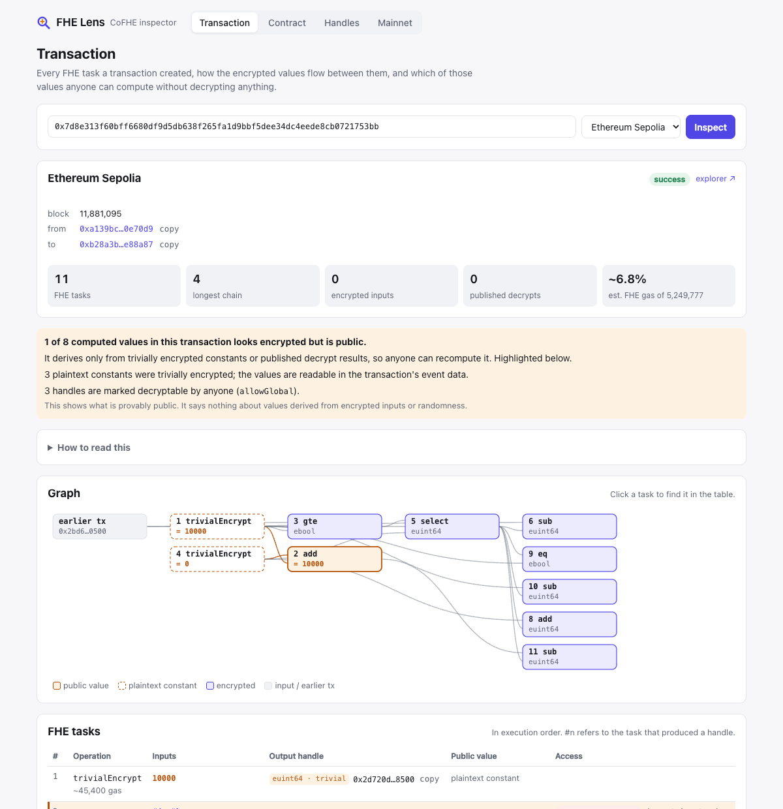
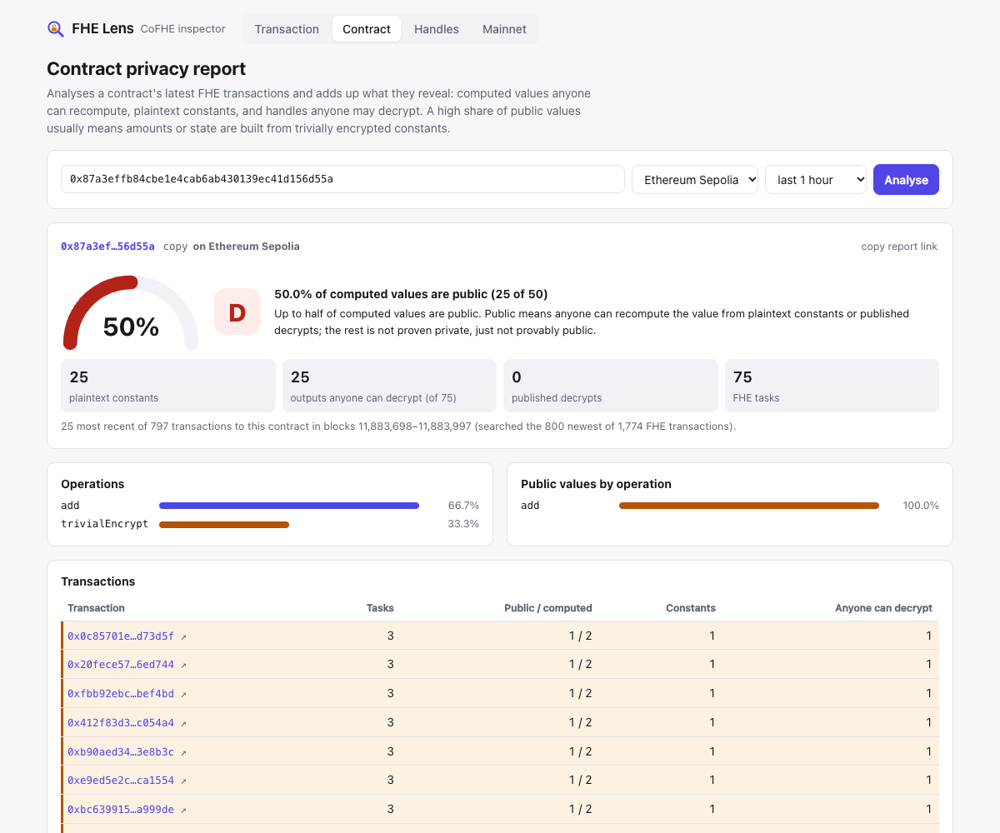

# FHEye

A client-side inspector for [Fhenix CoFHE](https://cofhe-docs.fhenix.zone), in the browser or on the [command line](#command-line). Paste a transaction and see every FHE task it created, how encrypted values flow between them, who may use each handle, and which values look encrypted but can be computed by anyone.

> Unofficial. Not affiliated with Fhenix. FHEye only reads public chain data; it never sends transactions or asks for a wallet.


## What it does

**Transaction view.** Give it a tx hash (the network is found automatically). The answer comes first, in plain language: which value looks encrypted but isn't, the sum that gives it away (`0 + 5,000,000 = 5,000,000`), what a developer could do about it and, when the value may be decrypted by anyone, a button that checks it against the CoFHE network. Under that, FHEye decodes every `TaskCreated`, `InputVerified` and `DecryptionResult` event the CoFHE TaskManager emitted and shows:

- the task graph, drawn as a layered diagram and listed in execution order, with each input linked to the task that produced it; selecting a task lights up everything it is computed from and spells out the formula;
- each output handle's type, security zone and trivial bit;
- access status per handle: decryptable by anyone (`allowGlobal`), decrypt result published on-chain, allowed for the calling contract and the sender;
- estimated gas per task (from the Fhenix docs gas table) and the FHE share of the tx's gas;
- **values that look encrypted but are public** (see below).



**Leak radar.** The latest CoFHE transactions on a network as they happen, refreshed every 30 seconds, each marked Exposed or Nothing found, with the contracts leaking most right now. Verdicts come from the scanned logs alone, following values across the transactions in the window.

**Search.** One box takes a transaction hash or a contract address; the network is found automatically.

**Contract privacy report.** Give it a contract address: FHEye finds the contract's latest FHE transactions on a network, analyses each one and adds up how many computed values are provably public, how many plaintext constants it encrypts, and how many of its handles anyone may decrypt. Handles are content-addressed, so each value is followed back through earlier transactions in the window: a balance that started from a trivially encrypted zero is still flagged in later transactions that only add to it. The report grades the share of public values (A only when nothing is provably public) and its link can be shared.



**Handle decoder.** Paste handles in bulk and read their type, trivial bit and zone offline. Optionally ask a network whether each handle is globally decryptable, whether a decrypt result was published, and whether a given address is allowed.

**Mainnet status.** The CoFHE TaskManager on Ethereum and Arbitrum One: whether intake is enabled, whether the access list is on, the allowlisted callers (rebuilt from events and checked against storage), role holders, signer history and the full admin event log. A recent-activity panel shows the op mix, the share of trivially encrypted values and the busiest contracts on any supported network.

## "Looks encrypted, but isn't"

A ciphertext handle is only as private as the data it was computed from. FHEye marks a handle as public when its value can be recomputed from:

- **trivially encrypted constants**: `FHE.asEuint64(10000)` puts `10000` in the event data, and the handle carries a trivial bit;
- **published decrypt results**, which anyone can read from the chain;
- **identities that hold for any input**, such as `x - x = 0`, `mul(x, 0) = 0`, or `select(c, a, a) = a`.

Values are recomputed with the semantics of [TFHE-rs](https://github.com/zama-ai/tfhe-rs), the library behind CoFHE's FHE engine, not the mock contracts (which differ for `not`, `rol`, `ror`, wide shifts and `rem` by zero). Where production behaviour hasn't been confirmed on a live CoFHE network, the result says what it assumes:

| Case | Assumed result | Source |
|---|---|---|
| `div(x, 0)` | type maximum | TFHE-rs docs |
| `rem(x, 0)` | `x` | TFHE-rs docs |
| `shl/shr/rol/ror` by ≥ bit width | amount taken modulo the width | TFHE-rs ≤ 1.6; 1.7+ returns 0 for shifts on overshift |

When a derived value can be checked against a decrypt result published on-chain, the UI shows whether they match. For handles marked decryptable by anyone (`allowGlobal`), you can also ask the CoFHE threshold network for the value: FHEye sends the same request as `@cofhe/sdk`'s `decryptForTx().withoutACP()` and checks the returned signature against the TaskManager's `decryptResultSigner`, so the value doesn't have to be trusted. If a published or network result ever contradicts FHEye, the chain wins and every value that relied on the same assumption is dropped.

**What this does not tell you.** Nothing is said about values derived from encrypted user inputs or randomness, and side channels (gas, control flow, timing) are out of scope. A handle that isn't marked is not proven private; it just isn't provably public.

## Networks

| Network | TaskManager |
|---|---|
| Ethereum, Arbitrum One | `0x52E7a0cAF234b266bCFAa6aA933a412FDe58432A` |
| Ethereum Sepolia, Arbitrum Sepolia, Base Sepolia | `0xeA30c4B8b44078Bbf8a6ef5b9f1eC1626C7848D9` |

Both resolve through the CoFHE address book at `0xC0F4e00E531a2B086492Ae3DCC1515038307196b`.

Defaults are keyless public RPCs picked for browser CORS and log history; you can set your own per network (stored only in your browser). Some notes from testing them:

- Many public endpoints prune old logs or need a key for archive queries, so log scans use endpoints that keep full history.
- Some endpoints silently truncate large `eth_getLogs` responses. FHEye never trusts a response above 5,000 logs and re-fetches the range in halves.
- Arbitrum's public RPC allows much wider block ranges for queries without topic filters, so mainnet history is fetched topic-less and decoded locally.

## Limits

- `TaskCreated` doesn't index the handle, so a handle created in an earlier transaction can't be looked up directly. Common trivially encrypted constants are recognised through a precomputed dictionary.
- ACL grants emit no events: "who can use this handle" can only be answered per address.
- Contract attribution uses the transaction's `to` address, which is the caller unless the call goes through a router.

## Run it

```sh
npm install
npm run dev        # http://localhost:5173
npm test           # unit tests, including fixtures from real Sepolia txs
npm run e2e        # smoke test in headless Chrome against live testnets
npm run build      # static site in dist/
```

Stack: Vite, React, TypeScript, [viem](https://viem.sh). No backend.

The `spike/` folder holds the scripts used to validate the approach against live networks (handle derivation on real events, RPC limits, ACL reads, mainnet status, leak recomputation against published decrypts). Run any of them with `npx tsx spike/<name>.ts`.

## Public API

Read-only JSON over HTTP, with open CORS and edge caching:

| Endpoint | Returns |
|---|---|
| `GET /api/tx/<hash>[?chain=<key>]` | The plain-language verdict (`exposed`, `private` or `none`, with the sum and the advice) and every FHE task of the transaction. The network is found automatically unless `chain` is given. |
| `GET /api/handle/<handle>[,<handle>…][?chain=<key>]` | Up to 20 decoded handles; with `chain`, whether anyone may decrypt each and any published result. |
| `GET /api/mainnet` | Live state of both mainnet TaskManagers: intake, access list, allowlisted callers, task counts. |
| `GET /api` | This list. |

Bigints are decimal strings and handles are 32-byte hex. The functions live in `api-src/` and are bundled into `api/` by `npm run build:api` before a deploy.

## Launch bot

`fheye watch --state <file>` compares the mainnet TaskManagers with its last run and posts what changed (a contract allowed or removed, intake switched on or off, the access list opened, the first encrypted operations with FHEye's verdict) to `DISCORD_WEBHOOK_URL` and/or `TELEGRAM_BOT_TOKEN` + `TELEGRAM_CHAT_ID`. The first run only records the state; `--dry-run` prints instead of posting.

`.github/workflows/launch-watch.yml` runs it every 10 minutes once the repository variable `WATCH_ENABLED` is `true` and one of those secrets is set; until then the job is skipped.

## Command line

The same analysis runs in a terminal or a CI job. It isn't published to npm; build it from a clone:

```sh
npm run build:cli                  # single file: dist-cli/fheye.mjs, runs with plain node
node dist-cli/fheye.mjs tx 0x7d8e313f60bff6680df9d5db638f265fa1d9bbf5dee34dc4eede8cb0721753bb
node dist-cli/fheye.mjs contract 0x87a3effb84cbe1e4cab6ab430139ec41d156d55a --chain sepolia --hours 6
node dist-cli/fheye.mjs handle 0x76c4c176dc23fd580abc40e3e30f30ee9c466e4b6adc6fbdc7c45425f1a50500 --chain sepolia
node dist-cli/fheye.mjs status  # mainnet TaskManagers
```

During development, `npx tsx cli/index.ts …` (or `npm run cli -- …`) runs the sources directly.

- `tx <hash>` lists every task with its inputs (`#n` is the task that produced a handle) and marks values that look encrypted but are public. The network is found automatically unless `--chain` is given.
- `contract <address> --chain <key>` is the contract privacy report over the last `--hours` (default 1).
- `handle <handle…>` decodes handles offline; with `--chain` it also asks whether anyone can decrypt them and whether a result was published.
- `status` shows intake, access list, roles and task counts on Ethereum and Arbitrum One.

Every command takes `--rpc <url>` to replace the public endpoints and `--json` to print one JSON document instead of text (bigints as decimal strings, handles as 32-byte hex). Networks: `ethereum`, `arbitrum`, `sepolia`, `arbitrum-sepolia`, `base-sepolia`.

Exit codes: `0` done; `1` with `--fail-on-public` (`tx`, `contract`) when at least one computed value is public; `2` usage error, bad input or RPC failure.

A CI step that fails when a contract's recent transactions leak computed values:

```yaml
- name: Check for public values
  run: |
    git clone --depth 1 https://github.com/kriss39/fheye /tmp/fheye
    cd /tmp/fheye && npm ci && npm run build:cli
    node dist-cli/fheye.mjs contract ${{ vars.CONTRACT }} --chain sepolia --hours 6 --fail-on-public
```

## License

MIT
